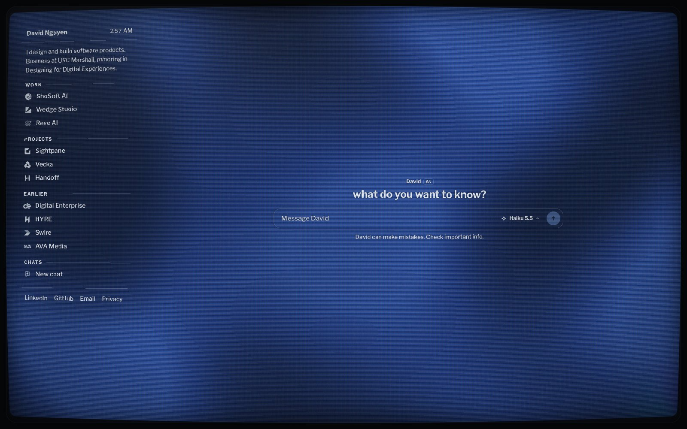
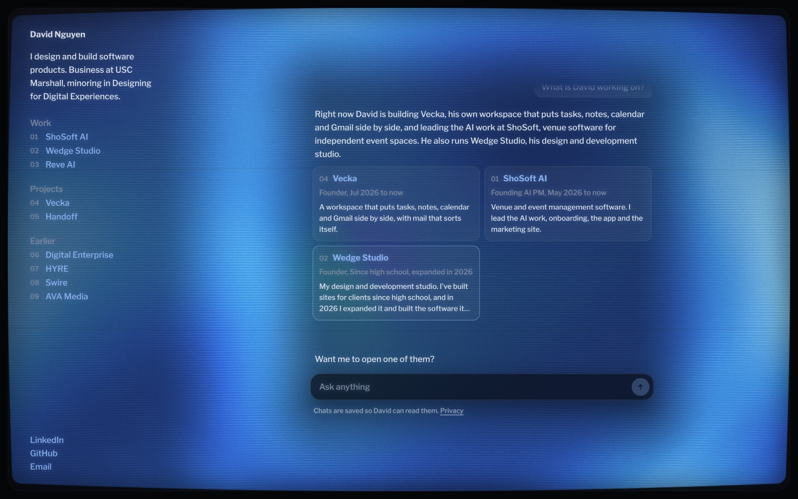
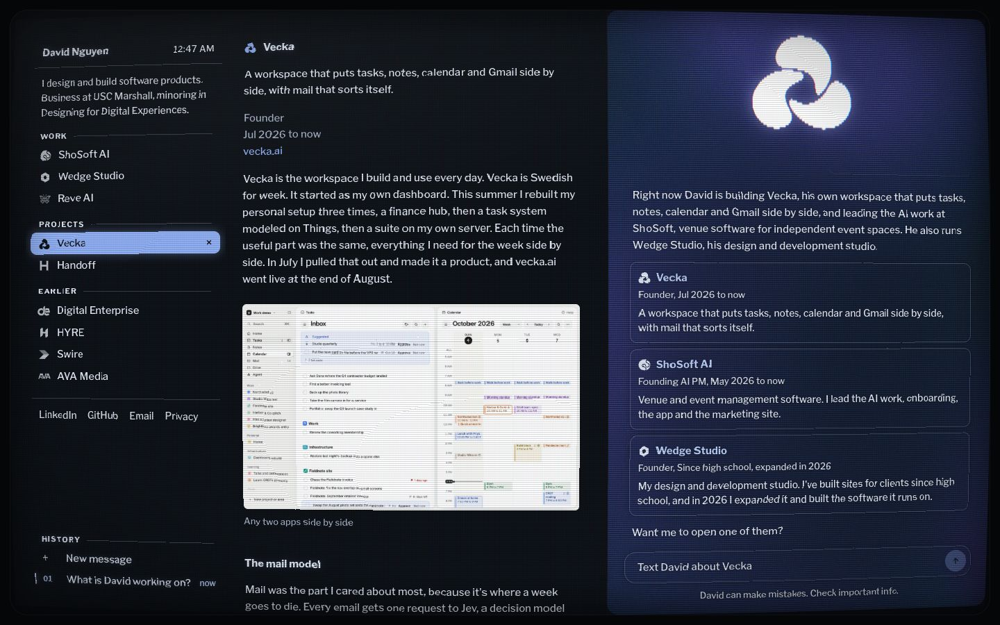
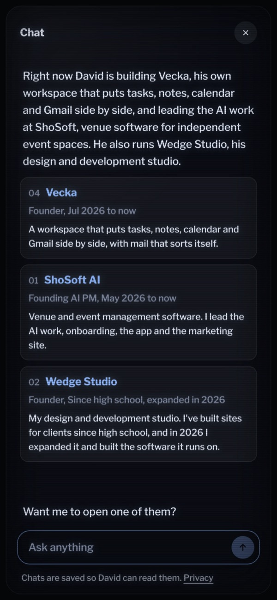

# daviddn.dev

My personal site, drawn as an old CRT television. Live at **[daviddn.dev](https://daviddn.dev)**.

I'm David Nguyen, a business student at USC Marshall with a minor in Designing for Digital Experiences. I design and build software products, and I'm looking for Summer 2027 internships in product management, AI product and product engineering. This repo is the site itself, and it doubles as a small example of how I work: a clear idea, real constraints, and the details carried all the way through.



## What it does

- **The whole page is the screen.** There is no sidebar beside a picture. My name, a line about me and every project sit on the glass in a guide panel composed like a TV's channel guide: a header strip with the time, every project marked by its own small logo in phosphor (its brand colour on hover), the open one on a selection bar. Up and down change the channel.
- **Projects slide in on the tube.** Picking one sweeps the picture's edge across the screen as a bright line of phosphor with a short afterglow, the write up easing in behind it, curved and scanlined with the glass the whole way. Closing slides it back; switching wipes the new write up in over the old with the same line. On phones it slides up over the guide. The screen splits: the write up in a reading column, and beside it a wide chat panel tinted with that brand's colour, kept as dark and quiet as the home picture so replies and cards stay readable, the project's logo glowing at its top.
- **A chat in the middle.** It's like texting me: one line from me picked at random above the box ("hey, it's david. ask me anything") and "David can make mistakes. Check important info." under it, because the one answering is an AI version of me. Answers stream in, and when it helps they come with project cards, a timeline or my contact details, or open a project on the page. The conversation follows you around the site: open a project and the chat docks beside it ("Text David about ShoSoft") and already knows which project and which part of it you're reading. Every visit starts a new chat, and every past one is listed in the sidebar under the guide to pick up again.
- **It feels like a real tube.** It powers on with a dot, a line and a short wobble, moving things leave a little afterglow, and the picture bends slightly near the cursor like a magnet near the glass.

| A question answered with cards | A project open, the chat panel beside it | On a phone |
|---|---|---|
|  |  |  |

## How it works

```
daviddn.dev  (this repo, Astro + React, static)
  ├─ the CRT        WebGL 2, four passes a frame (src/components/site/crt.ts)
  ├─ the guide      real HTML links on the glass, so it stays accessible and indexable
  ├─ the chat       assistant-ui, talking to POST /a/chat
  └─ the tracker    a tiny first party script, POST /a/e

/a/*  →  a small Node service on my own server (private repo)
           ├─ chat      Claude Haiku 5.5, grounded in a public profile of my work
           ├─ analytics visits, reading depth, clicks, where people came from
           └─ internal  a private dashboard for the site and my job search
```

### The CRT

The picture is rendered in four WebGL 2 passes every frame.

1. **Signal.** The drifting colour field, the open project's logo, the cursor's magnet and the power on, drawn one row per scanline into the last frame's phosphor, which fades a little each frame. That fade is the afterglow.
2. **Halation, two passes.** The bright parts, shrunk and blurred, for the soft light that spreads inside the glass.
3. **The tube.** Each pixel finds its place on a gently curved raster, then gets scanlines that swell with brightness, a hair of colour fringing toward the edges, a faint aperture grille, a slow refresh band, grain and rounded corners.

Everything that is HTML on the screen (the guide, the chat, the write ups) bends with the glass too. An SVG displacement filter made for the screen's size curves those layers with exactly the shader's formula, so a line of text bows the way the picture does, and the same scanlines, a faint aperture grille, phosphor glow and corner falloff run over the text. Where text sits, the picture quietly dims and flattens in a wide soft oval instead of a box.

Scanlines always land on whole device pixels so they never shimmer, and the render size has a pixel budget so it stays smooth on large screens. Logos are distance fields, so switching projects can melt one outline into the next. Light mode is a CRT in a lit room, grey glass and lower contrast. Reduced motion turns off the power on, afterglow and grain and only redraws on change, and browsers without WebGL 2 get the same picture drawn on a 2D canvas, bent onto the same curve with the same scanlines.

### The chat

The chat UI is built on [assistant-ui](https://github.com/assistant-ui/assistant-ui)'s unstyled pieces, restyled so the text reads as if it's on the glass: no panel behind it, light phosphor text with a tight dark halo so it holds up over the brightest part of the picture, and thin phosphor outlines for the box and the cards. It's deliberately bare, a line, the box and one line under it. Once a conversation starts the box settles to the bottom and each question pins to the top while its answer types out below it.

- **One conversation across the site.** Opening, switching and closing projects keep it. With a project open it becomes a full panel beside the article, the conversation in the middle and the box at the bottom; on phones it's a bar that opens into a full screen conversation, over the article too.
- **It knows where you are.** Every message carries the open project, the heading you're reading in its write up, how far down you are, and whether you're on a phone, so "tell me more about this part" works.
- **New chat and History.** A page load starts a new conversation. Once talking, a row at the top shows what the chat is about, New chat (⌘K) and Close (Esc), which ends it and goes back to the empty chat. Past ones are kept in your browser only (`localStorage`). History is listed in the guide, under the projects and above the links, in every view and on phones, laid out like the guide's channels: New message at the top, then every conversation newest first, numbered in the order they were started, titled by its first question, with how long ago it was used and the one on screen marked. On phones it's a button at the start of the chat bar that opens the list full screen. Coming Back to the page picks the last conversation up again.
- **Texts back and forth.** Your messages sit on the right as bright outlined bubbles, mine on the left in darker filled ones, each sized to its words, with cards attached under my reply. While I'm "typing" there are three dots, then the words stream into the bubble. My first reply carries my name and an AI tag.
- **Sources.** When I say where something comes from, a small numbered chip follows the claim and the sources line up under my reply, each with its project's mark and the part of the write up it's from. The project's channel in the guide flickers as a source arrives, as if the set were tuning in. Choosing a source opens the project and scrolls to that heading, which glows for a moment.
- **Motion.** Everything moves on one curve and enters a little up and in; the answer streams in at an even pace whatever the network does, cards follow one after another, and the chat fades rather than slides when it changes place. Reduced motion turns it all off.

It streams from `/a/chat`, a small endpoint on my server that calls Claude Haiku 5.5. The model only knows a written profile of my public work, and it answers with tool calls the page renders as cards or acts on (`open_project`, `close_project`, `show_projects`, `show_timeline`, `show_contact`, `show_resume`).

Guardrails, in the order a message meets them.

- same site requests only, and known bots are refused
- one message at a time per visitor, 800 characters at most, a short history
- per address and per visitor limits per minute and per day
- a daily spending cap for the whole site, after which the chat says it's resting
- a system prompt that keeps it on my work, never shares private details, and treats instructions inside messages as conversation

The profile is cached, so a typical answer costs well under a tenth of a cent.

### Details

- **The pointer is pixel art.** An arrow, a pointing hand and an I-beam drawn like an early GUI's, with a one pixel phosphor halo, at 1x and 2x so they stay crisp. Phosphor white in the dark, ink in a lit room. Touch screens keep their own.
- **Every page is on the set.** Privacy, the resume link and a miss all sit on the same tube, the picture calm behind the text. A page that doesn't exist shows snow and says there is no signal.
- **Motion is quiet.** Focus is a phosphor ring that settles in, links trace an underline on hover, screenshots come on once loaded, pages fade into each other, and reduced motion turns all of it off.
- **The icon is a little CRT**, and sharing the site shows the home screen.

### Privacy

The site counts visits with my own script, not a third party. It keeps a random id in the browser, never stores IP addresses, sets no cookies and runs no ads. Browsers that send Do Not Track or Global Privacy Control are not counted at all. Chats are saved so I can read and reply. That's spelled out on the privacy page, which is one of the links in the guide. The plain words version is at [daviddn.dev/privacy](https://daviddn.dev/privacy/).

## The projects on it

| | What | Role |
|---|---|---|
| [ShoSoft AI](https://daviddn.dev/projects/shosoft/) | Software for independent event venues. AI onboarding that reads a venue's website and handbook | Founding AI PM |
| [Wedge Studio](https://daviddn.dev/projects/wedge/) | My design and development studio, and the software it runs on | Founder |
| [Reve AI](https://daviddn.dev/projects/reve/) | Growth at an image model lab: launch pages, campaigns, the team's internal tool | Growth engineer |
| [Vecka](https://daviddn.dev/projects/vecka/) | A workspace with tasks, notes, calendar and Gmail side by side, with mail that files itself | Founder |
| [Handoff](https://daviddn.dev/projects/handoff/) | A student sublease marketplace that shows what you save on every listing | Co-founder |

Earlier ventures (Digital Enterprise, HYRE, Swire, AVA Media) are on the site too.

## Project structure

```
src/
  pages/            index, /projects/<slug>/, /cv/ (opens the resume), /privacy/, 404
  layouts/          Base.astro, and Screen.astro for the plain pages on the set
  styles/           site.css (the screen), details.css (pointer, focus, pages)
  components/site/
    App.tsx         layout, the guide, routing, keyboard, the chat slot
    crt.ts          the WebGL CRT
    screen2d.ts     the same picture on a 2D canvas, without WebGL
    marks.ts        logos as distance fields
    palette.ts      brand colours and blending
    Panel.tsx       the article
    chat/           Chat.tsx and Live.tsx, the runtime adapter, the cards, History (Corner.tsx, store.ts), chat.css
  data/work.js      every project and its write up, the one content file
public/work/        images and video for each project
public/cursors/     the pixel pointer, 1x and 2x
integrations/       a build step that drops media no page uses
```

## Run it

```bash
npm ci
npm run dev
```

The chat and the tracker need my server, so locally the chat shows an error and nothing is counted. Everything else works.

Every push to `main` builds the site on GitHub and ships it to my server, where each deploy is a new release folder switched in by a symlink, with an automatic rollback if the home page check fails.

## Stack

Astro 5, React 19, TypeScript, WebGL 2, assistant-ui. The server side is Node 22 with SQLite, behind Caddy on a VPS I run myself.

## Contact

[daviddn@usc.edu](mailto:daviddn@usc.edu) · [LinkedIn](https://linkedin.com/in/daviddn) · [Resume](https://daviddn.dev/cv/)
